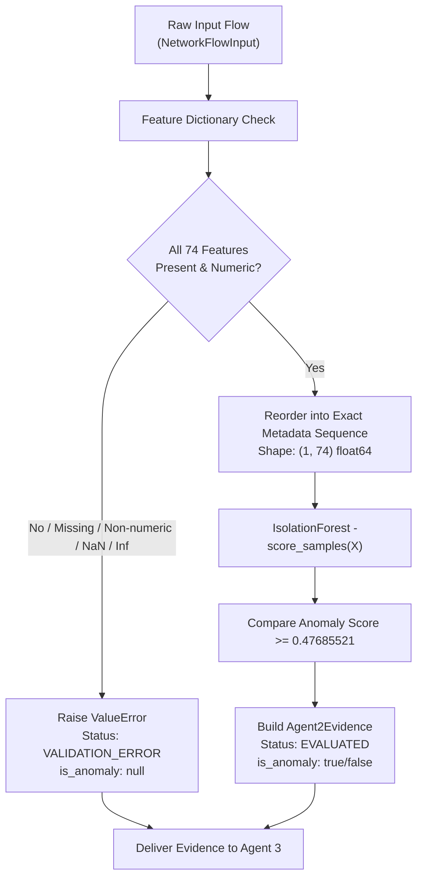

# Agent 2: Network Anomaly Detection Architecture

## 1. Overview & Role in Dark-Trace-AI

**Dark-Trace-AI** employs a multi-agent cybersecurity architecture designed for resilient, explainable, and autonomous network threat detection.

```
+-----------------------------------------------------------+
|                     Network Flow Data                     |
+-----------------------------+-----------------------------+
                              |
              +---------------+---------------+
              |                               |
              v                               v
    +-------------------+           +-------------------+
    |      Agent 1      |           |      Agent 2      |
    |    (Supervised    |           |   (Unsupervised   |
    |  Classification)  |           | Anomaly Detection)|
    +---------+---------+           +---------+---------+
              |                               |
              | Supervised                    | Anomaly Evidence
              | Evidence                      | (IF Scores)
              |                               |
              +---------------+---------------+
                              |
                              v
                    +-------------------+
                    |      Agent 3      |
                    | (Evidence Fusion  |
                    | & Final Verdict)  |
                    +-------------------+
```

### Core Architecture Rules

1. **Independent Execution**:
   - Agent 1 performs supervised classification of known threat patterns.
   - Agent 2 performs unsupervised network anomaly detection of unknown/statistical outliers.
   - **Agent 1 and Agent 2 do NOT depend on each other.** Agent 2 never reads, requires, or waits for Agent 1's outputs.
2. **Evidence Fusion by Agent 3**:
   - Both Agent 1 and Agent 2 deliver objective evidence to Agent 3.
   - **Agent 2 does NOT make final threat decisions.** It produces calibrated anomaly scores and statistical deviations, leaving decision fusion to Agent 3.
3. **No External Threat Intelligence**:
   - TinyFish and all external threat-intelligence services have been completely removed.
   - Agent 2 focuses exclusively on statistical network anomaly detection.
   - To preserve Agent 3 contract compatibility, the evidence payload retains a non-fabricating `threat_intelligence` block marked explicitly as `status: "DISABLED"`.

---

## 2. Machine Learning Model Architecture

Agent 2 uses a scikit-learn **Isolation Forest** trained exclusively on benign network traffic from the **CICIDS2017** dataset.

### Training Configuration
- **Estimator**: `IsolationForest`
- **Number of Estimators**: 300
- **Subsample Size (`max_samples`)**: 1024
- **Feature Sampling (`max_features`)**: 1.0
- **Bootstrap**: False
- **Random State**: 42
- **Training Population**: 192,000 BENIGN network flows
- **Feature Count**: 74 numerical features

### Calibrated Anomaly Threshold
- **Calibrated Threshold**: `0.47685521` (exact: `0.47685521147215626`)
- **Calibration Method**: 95th percentile of benign validation anomaly scores computed using NumPy's `method="higher"`.
- **Score Definition**: Negative scikit-learn `score_samples`:
  $$\text{anomaly\_score} = -\text{model.score\_samples}(X)$$
- **Score Interpretation**:
  - Higher scores indicate greater deviation from benign baseline traffic.
  - Scores are uncalibrated outlier scores, **not** probabilities or confidence values.
  - Normalization is explicitly omitted (`normalized_score: null`) to prevent false probability representation.
- **Decision Rule**:
  $$\text{is\_anomaly} = (\text{anomaly\_score} \ge 0.47685521)$$

---

## 3. Evaluation Results on Test Dataset

The model was evaluated against an untouched test partition of 114,185 network flows from CICIDS2017:

| Metric | Result |
| :--- | :--- |
| **Total Evaluation Flows** | 114,185 |
| **True Positives (TP)** | 33,046 |
| **False Positives (FP)** | 2,931 |
| **True Negatives (TN)** | 57,070 |
| **False Negatives (FN)** | 21,138 |
| **Precision** | **91.85%** |
| **Recall** | **60.99%** |
| **F1-Score** | **73.30%** |
| **Balanced Accuracy** | **78.05%** |
| **False Positive Rate (FPR)** | **4.88%** |
| **ROC-AUC** | **90.94%** |
| **Average Precision** | **82.77%** |

*Note: The complete evaluation report is preserved in `src/dark_trace/agent2/artifacts/agent2_final_evaluation.json` and `src/dark_trace/agent2/reports/original_dataset_evaluation.json`.*

---

## 4. 74-Feature Validation & Inference Pipeline

The inference engine strictly enforces the 74-feature schema verified from model metadata:



### Strict Feature Rules:
1. **Exact 74-Feature Requirement**: All 74 features specified in `agent2_metadata.json` must be present.
2. **Deterministic Ordering**: Incoming dictionary keys are reordered strictly matching `feature_names_in_`.
3. **No Silent Imputation**: Missing values are never filled with zero or defaults; missing features raise an immediate `ValueError`.
4. **Finite Float Verification**: Values must convert to `float`. `NaN`, `+inf`, and `-inf` are explicitly rejected.
5. **Extra Keys Handled**: Non-feature keys (e.g. metadata) are ignored while the required 74 features are extracted.

---

## 5. Artifact Resolution & Model Loading

All paths are dynamically anchored to `src/dark_trace/agent2/`:

- Model: `src/dark_trace/agent2/artifacts/agent2_isolation_forest.joblib`
- Metadata: `src/dark_trace/agent2/artifacts/agent2_metadata.json`
- Evaluation: `src/dark_trace/agent2/artifacts/agent2_final_evaluation.json`

### Model Readiness States:
- **`is_loaded() == True`**: Both joblib model and metadata JSON loaded, estimator type verified as `IsolationForest`, 74 features confirmed, threshold finite.
- **Model Unavailable / Corrupt**: Agent 2 returns:
  - `status: "MODEL_NOT_READY"`
  - `is_anomaly: null`
  - `raw_score: null`
  - It **never** reports `is_anomaly: false` (normal) on an un-evaluated flow.

---

## 6. Agent 3 Integration Contract

Agent 2 formats its output into the standardized evidence contract:

```json
{
  "agent_id": "A2",
  "flow_id": "flow-demo-1001",
  "timestamp": "2026-10-31T02:00:00Z",
  "anomaly_evidence": {
    "status": "EVALUATED",
    "is_anomaly": true,
    "anomaly_label": "ANOMALOUS",
    "raw_score": 0.542198,
    "normalized_score": null,
    "anomaly_score": 0.542198,
    "threshold": 0.47685521147215626,
    "decision_threshold": 0.47685521147215626,
    "model_version": "IsolationForest",
    "supporting_features": [],
    "inference_latency_ms": 5.43
  },
  "threat_intelligence": {
    "status": "DISABLED",
    "investigation_status": "NOT_APPLICABLE",
    "is_enriched": false,
    "provider": "none",
    "findings": [],
    "sources": [],
    "reputation_summary": "Threat intelligence disabled; Agent 2 is purely network anomaly detection.",
    "details": {}
  },
  "routing_metadata": {
    "src_ip": "192.168.1.15",
    "dst_ip": "10.0.0.1",
    "src_port": 54321,
    "dst_port": 443,
    "protocol": "TCP"
  }
}
```
